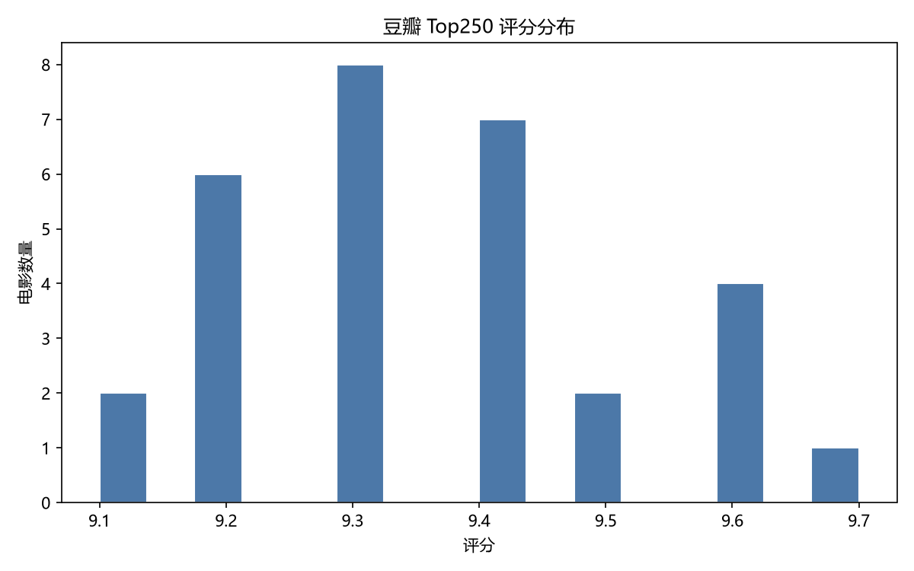
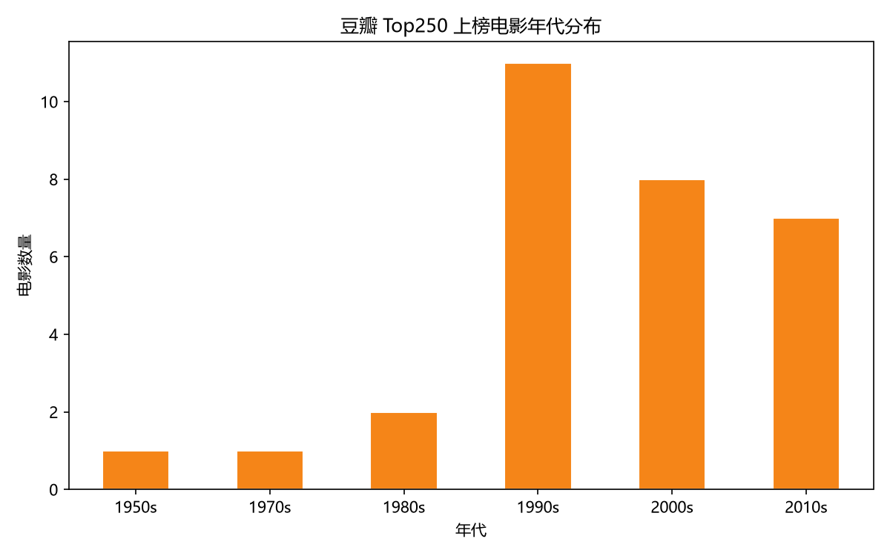
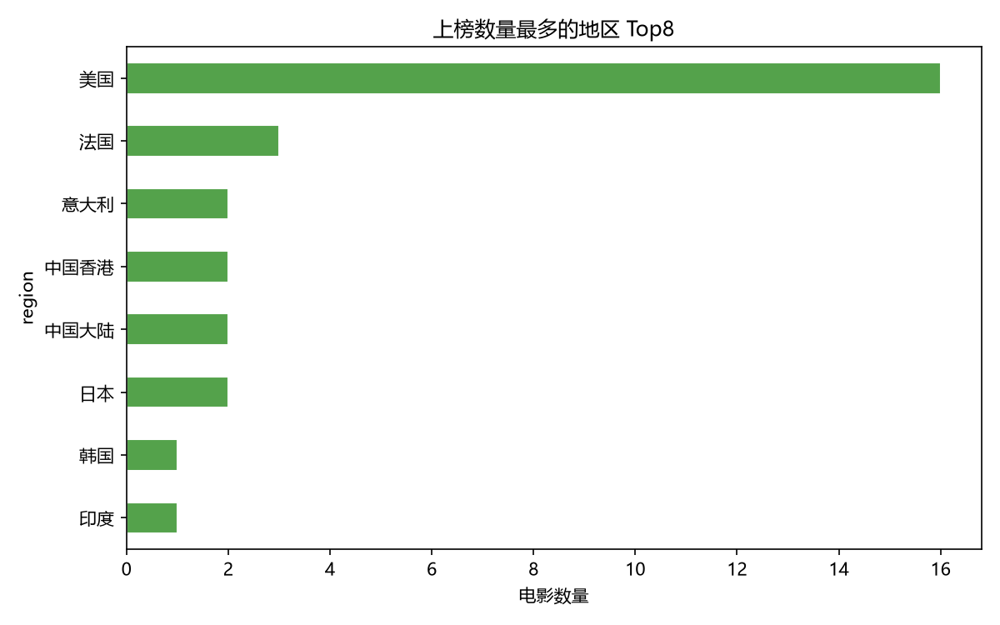

# 豆瓣电影 Top250 数据爬取与可视化分析

使用 **Python** 完成「爬虫 → 清洗 → 分析 → 可视化」全流程：爬取豆瓣电影 Top250 榜单数据，用 Pandas 清洗统计，用 Matplotlib 生成可视化图表。

## 功能特性

- **数据爬取**：Requests + BeautifulSoup 抓取排名、名称、评分、年份、地区、类型、短评等信息，随机延时防止请求过快
- **数据清洗**：Pandas 类型转换、缺失值剔除
- **统计分析**：评分区间、平均评分、地区分布、年代分布、高分电影榜
- **可视化**：评分分布直方图、年代分布柱状图、地区 Top8 条形图
- **离线可用**：内置示例数据（`data/sample_top250.csv`），无网络也能跑通完整分析流程

## 技术栈

`Requests` · `BeautifulSoup4` · `Pandas` · `Matplotlib`

## 项目结构

```
douban-top250-analysis/
├── main.py                 # 主流程：爬虫 -> 清洗 -> 分析 -> 可视化
├── scraper.py              # 爬虫：抓取与解析，保存 CSV
├── analysis.py             # 分析：Pandas 统计 + Matplotlib 出图
├── requirements.txt
├── data/
│   └── sample_top250.csv   # 内置示例数据（Top30）
└── charts/                 # 生成的图表（评分分布 / 年代趋势 / 地区分布）
```

## 快速开始

```bash
pip install -r requirements.txt

# 离线模式：使用内置示例数据跑通分析流程
python main.py

# 联网模式：抓取完整 Top250 后分析
python main.py --scrape
```

## 输出示例

终端统计报告（节选）：

```
==============================================
样本总量：250 部
评分范围：8.3 ~ 9.7，平均评分 8.78
年份范围：1931 ~ 2023
...
==============================================
```

| 评分分布 | 年代分布 | 地区分布 |
| --- | --- | --- |
|  |  |  |

> 注：爬虫仅用于学习交流，请控制抓取频率，遵守豆瓣 robots 协议。
